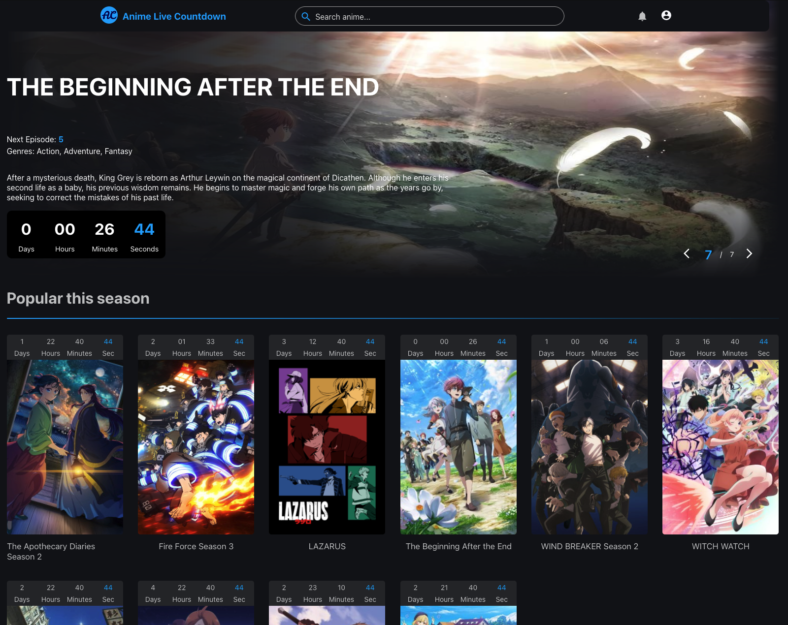

<div align="center">
  

# Anime Live Countdown

**Track every airing anime this season with live episode countdowns, reminders, and AniList sync**

[animelivecountdown.com](https://animelivecountdown.com)

[](https://angular.dev/)
[](https://spring.io/projects/spring-boot)
[](https://openjdk.org/)
[](https://supabase.com/)
[](https://www.oracle.com/cloud/)
[](https://vercel.com/)

</div>

---

## 📖 About The Project

<div align="center">
  
</div>

<br>

Anime Live Countdown helps anime fans keep up with the current season. Shows are grouped by the **day of the week they air**, so every countdown has context: you can see at a glance what's coming tonight, tomorrow, and later in the week. Signed-in users can follow shows, track which episodes they've watched, get reminders when new episodes drop, and keep it all in sync with their AniList account.

### ✨ Key Features

**Discover**
- 📅 **Weekly schedule** with live countdowns, grouped by airing day (each day also has its own page)
- 🔴 **Live banner** for episodes airing right now, with a celebration when a countdown hits zero
- 🔥 **Trending sidebar** and a **Most Hyped** ranking based on follows and reactions
- 🗓️ **Season browser** for the current season and past ones (`/seasons/2026/fall`)
- 🔍 **Search** with instant results
- ⏸️ **Break and delay detection**: shows that are on hiatus or delayed are flagged on cards and show pages

**Show pages**
- 🎬 Trailer, franchise **watch order**, and **where to watch** (streaming links)
- 🕒 **Streaming and dub release times** from AnimeSchedule.net
- 😍 **Episode reactions** (🔥 😍 😂 😱 😭 😐)
- 🔗 **Share button** with generated share-card images

**Personal tracking**
- ⭐ **Following** with per-show episode progress, a personal schedule, and a "continue watching" row
- 🔄 **Two-way AniList sync**: import your list, and push follows and watched episodes back to AniList
- 🔔 **Episode reminders** through an in-app notification bell, browser **Web Push**, **Discord webhooks**, or a personal **calendar feed** (`.ics`)
- 📲 **Installable PWA**

**Everywhere**
- 👤 Sign in with **Google, GitHub, or Discord** (OAuth2 + JWT with refresh-token cookies)
- 🌗 **Light and dark themes**
- 🚀 **Server-side rendering** with per-page SEO metadata, canonical URLs (`/anime/:id/:slug`), sitemaps, and optimized images
- 📱 Responsive layout for mobile, tablet, and desktop

---

## 🛠️ Built With

### Frontend

- **[Angular 20.3](https://angular.dev/)** with standalone components, signals, and **Angular SSR** (Express)
- **[RxJS 7.8](https://rxjs.dev/)**
- **[TypeScript 5.9](https://www.typescriptlang.org/)**
- Service worker for Web Push and PWA install

### Backend

- **[Spring Boot 3.5](https://spring.io/projects/spring-boot)** on **Java 25**
- **Spring Security** with OAuth2 client (Google, GitHub, Discord) and JWT (jjwt)
- **Spring Data JPA** with **PostgreSQL** hosted on **[Supabase](https://supabase.com/)**
- **Spring GraphQL client** for the [AniList API](https://docs.anilist.co/), with rate limiting and caching
- **Scheduled jobs** that sync airing schedules, media info, and release times, and send episode reminders
- **[Maven](https://maven.apache.org/)** (wrapper included)

### External data

- **[AniList](https://anilist.co/)**: schedules, media info, trailers, relations, and user list sync
- **[AnimeSchedule.net](https://animeschedule.net/)**: streaming and dub release times

### Infrastructure & Deployment

- **[Vercel](https://vercel.com/)**: frontend and SSR
- **[Oracle Cloud](https://www.oracle.com/cloud/)** Ampere A1 (arm64) VM: backend in **Docker**, behind **[Caddy](https://caddyserver.com/)** for automatic HTTPS at `api.animelivecountdown.com`
- **[imgproxy](https://imgproxy.net/)** on the same VM: resizes cover and banner images to WebP at `img.animelivecountdown.com`, falling back to the original AniList image if it can't deliver
- **GitHub Actions**: builds the backend image on an ARM runner, pushes it to Docker Hub, and redeploys the VM over SSH on every push to `main` that touches `animeCountdownBackend/`

---

## 🚀 Getting Started

### Prerequisites

- Node.js 20.19+ and npm (Angular 20's minimum)
- JDK 25
- A PostgreSQL database (local or Supabase)

### Backend

The backend reads its secrets from environment variables. The minimum to start locally:

| Variable | Purpose |
| --- | --- |
| `SUPABASE_DB_URL` | JDBC URL (defaults to `jdbc:postgresql://localhost:5432/postgres`) |
| `SUPABASE_DB_USERNAME` | DB user (defaults to `postgres`) |
| `SUPABASE_DB_PASSWORD` | DB password |
| `JWT_SECRET_KEY` | Signing key for access tokens |
| `GOOGLE_CLIENT_ID` / `GOOGLE_CLIENT_SECRET` | Google sign-in |
| `GITHUB_CLIENT_ID` / `GITHUB_CLIENT_SECRET` | GitHub sign-in |
| `DISCORD_CLIENT_ID` / `DISCORD_CLIENT_SECRET` | Discord sign-in |

Optional:

| Variable | Purpose |
| --- | --- |
| `VAPID_PUBLIC_KEY` / `VAPID_PRIVATE_KEY` / `VAPID_SUBJECT` | Web Push notifications |
| `DISCORD_WEBHOOK_NOTIFICATIONS_ENABLED` | Turn on Discord webhook reminders (default `false`) |
| `ANIMESCHEDULE_TOKEN` | AnimeSchedule.net API token for release times |

```bash
cd animeCountdownBackend
./mvnw spring-boot:run
```

The `dev` profile is active by default and serves the API at `http://localhost:8080/api/`.

### Frontend

```bash
cd animeCountdownApp
npm install
npm start
```

Open `http://localhost:4200`. The development environment points at the local backend.

Other scripts:

| Command | What it does |
| --- | --- |
| `npm run build` | Production build (browser + server bundles) |
| `npm run serve:ssr` | Run the built SSR server locally |
| `npm test` | Unit tests |
| `npm run test:slugs` | Check the URL slug generator |

---

## 📁 Project Structure

```
AnimeLiveCountdown/
├── animeCountdownApp/              # Angular frontend (SSR)
│   ├── src/
│   │   ├── app/
│   │   │   ├── auth/               # Auth guard, interceptor, service
│   │   │   ├── header/             # Search, sign-in, profile menu, notification bell
│   │   │   ├── home/               # Hero carousel, live banner, most hyped, weekly schedule
│   │   │   ├── media-info/         # Show page: trailer, watch order, where to watch,
│   │   │   │                       #   release times, reactions, follow controls
│   │   │   ├── seasons/            # Season browser
│   │   │   ├── schedule-day/       # Single-day schedule page
│   │   │   ├── most-hyped-page/
│   │   │   ├── following/          # Followed shows, progress, AniList panel
│   │   │   ├── notification-settings/
│   │   │   ├── shared-components/  # Sidebar, reminder dialog, share button, etc.
│   │   │   ├── seo/                # Meta tags, slugs, sitemap, SSR helpers
│   │   │   ├── theme/              # Light/dark theme
│   │   │   ├── services/           # API clients and state
│   │   │   └── models/
│   │   ├── server.ts               # Express SSR server
│   │   └── environments/
│   ├── public/                     # Icons, images, service worker, manifest
│   ├── scripts/                    # Vercel build and slug checks
│   └── vercel.json
│
├── animeCountdownBackend/          # Spring Boot API
│   ├── src/main/java/.../
│   │   ├── controllers/            # REST endpoints
│   │   ├── services/               # Schedule sync, discovery, notifications,
│   │   │                           #   release times, share cards, watch order
│   │   ├── anilist/                # AniList OAuth, import, and two-way sync
│   │   ├── config/                 # Security, caching, GraphQL client
│   │   ├── components/             # JWT filter, OAuth success handler, rate limiter
│   │   ├── models/                 # JPA entities and AniList GraphQL models
│   │   └── repositories/
│   ├── deploy/                     # Oracle VM setup, Caddyfile, and imgproxy script
│   ├── Dockerfile
│   └── pom.xml
│
├── .github/workflows/              # Backend deploy pipeline
├── LICENSE
└── README.md
```

---

## 🗺️ Roadmap

### ✅ Shipped

- [x] Weekly schedule with live countdowns, airing soon, and season popularity
- [x] Search and detailed show pages
- [x] Sign-in with Google, GitHub, and Discord
- [x] Following with episode progress (replaced Favorites)
- [x] Two-way AniList sync
- [x] Episode reminders: in-app, Web Push, Discord webhooks, calendar feed
- [x] Installable PWA
- [x] Season browser and seasonal archive
- [x] Break and delay detection
- [x] Episode reactions and Most Hyped ranking
- [x] Share cards
- [x] Trailers, watch order, where to watch, streaming and dub release times
- [x] Light and dark themes
- [x] Server-side rendering and SEO

### 🔮 Ideas

- [ ] Email reminders
- [ ] Genre, studio, and dub-availability filters
- [ ] User reviews and ratings
- [ ] Community discussion

---

## 📄 License

Distributed under the MIT License. See [LICENSE](LICENSE) for more information.

---

## 🤝 Contributing

Contributions, issues, and feature requests are welcome. Feel free to open an issue.

---

<div align="center">
  Made with ❤️ for the anime community
</div>
